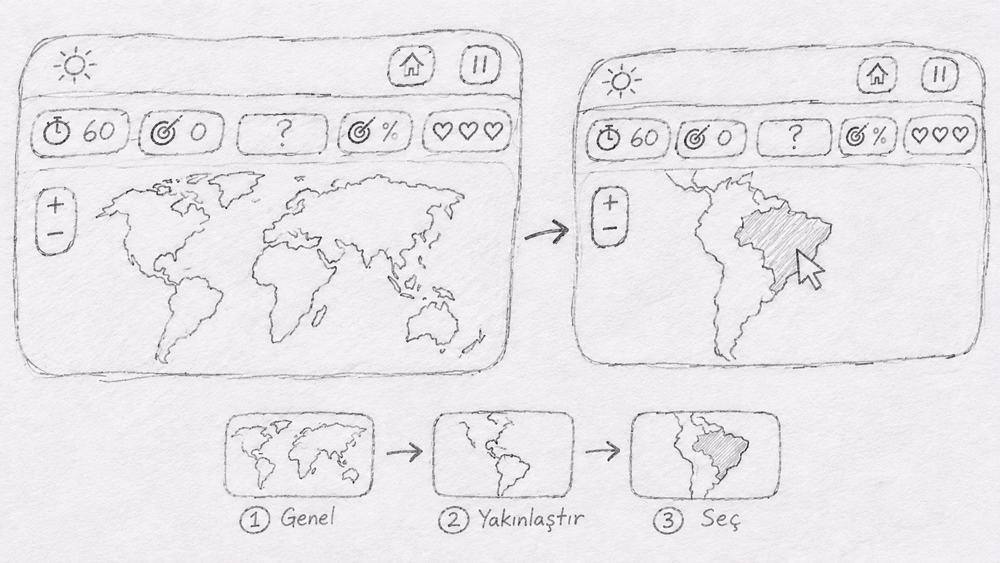

# country-rush
geogame homework for GMT458
# COUNTRY RUSH

Country Rush is a web-based geography game. The player tries to find as many countries as possible on the world map in 60 seconds.

## Game Rules

- The game lasts 60 seconds.
- The player has 3 lives.
- Each correct answer gives 100 points.
- Wrong answers cost 1 life and the next question starts.
- Questions go from easy to hard.
- The map zooms to the region of the target country.
- Accuracy is calculated from correct and total answers.

## Requirements

- Interactive world map
- Country selection by clicking on the map
- Timer, score, lives and accuracy display
- Light and dark mode
- Simple interface that works on desktop browsers

## Libraries and Tools

- **HTML, CSS, JavaScript:** Game and interface
- **Leaflet.js:** Interactive map
- **GeoJSON:** Country borders
- **Chart.js:** Game statistics
- **Node.js, Express, MongoDB:** Saving scores and leaderboard

## Interface Design

The game will have a simple design with a modern world map. The timer and accuracy will be clearly visible. A light/dark mode button will be placed in the top-left corner. 

