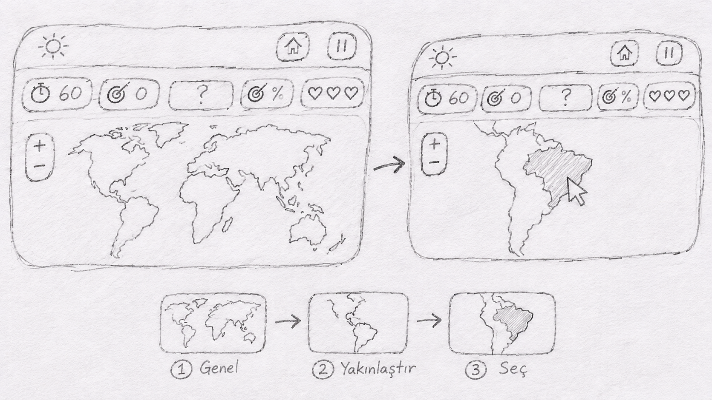

# country-rush
geogame homework for GMT458
# COUNTRY RUSH

Country Rush is a web-based geography game. The player tries to find as many countries as possible on the world map in 60 seconds.

## Game Rules

- The game lasts 60 seconds.
- The player has 3 lives.
- Each correct answer gives 100 points.
- Wrong answers cost 1 life and the next question starts.
- Questions go from easy to hard.
- The map zooms to the region of the target country.
- Accuracy is calculated from correct and total answers.

## Requirements

- Interactive world map
- Country selection by clicking on the map
- Timer, score, lives and accuracy display
- Light and dark mode
- Simple interface that works on desktop browsers

## Libraries and Tools

- **HTML, CSS, JavaScript:** Game and interface
- **Leaflet.js:** Interactive map
- **GeoJSON:** Country borders
- **Chart.js:** Game statistics
- **Node.js, Express, MongoDB:** Saving scores and leaderboard

## Interface Design

The game will have a simple design with a modern world map. The timer and accuracy will be clearly visible. A light/dark mode button will be placed in the top-left corner. 

## Implementation

I developed the game using HTML, CSS and JavaScript. I used Leaflet.js and GeoJSON for the map and Chart.js for the result chart.

### Event Handlers

- Starting the game when the Start Game button is clicked.
- Checking the answer when a country is clicked on the map.
- Switching between light and dark modes when the theme button is clicked.

### Closures

I used closures in the `createGame()` function to keep variables such as time, score and lives private and manage them through functions.

### DOM Interaction

I used `getElementById()` and `textContent` to update the timer, score, lives and accuracy in real time.

### Game Features

I added automatic map zoom, difficulty levels, answer animations and a leaderboard. I used localStorage to save player scores.

 ### AI Usage

I used ChatGPT to learn about map creation, game mechanics, closures and how to fix JavaScript errors.

